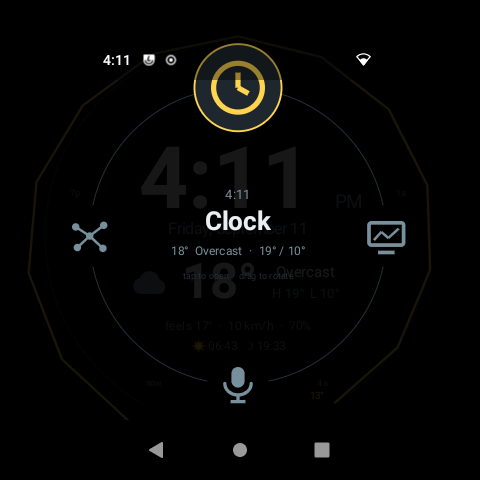
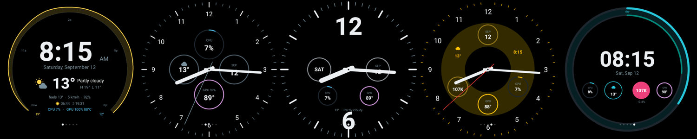
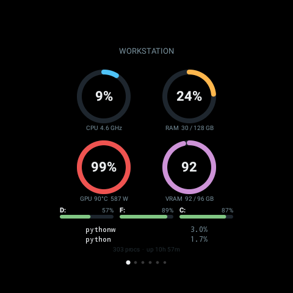
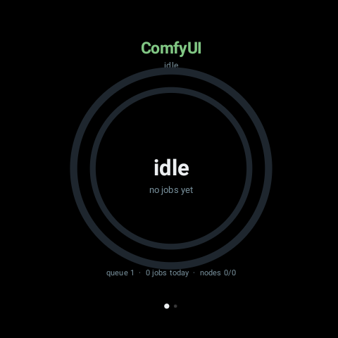
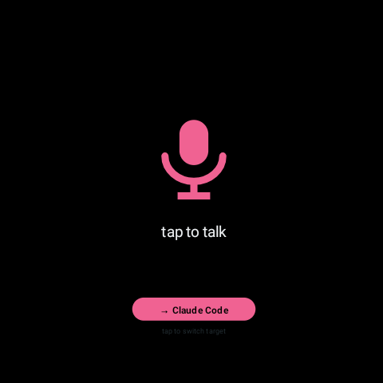
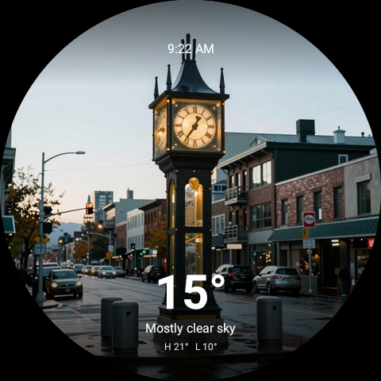

# EchoPortal

[](https://github.com/PartiallyFrozen/EchoPortal/actions/workflows/ci.yml)
[](LICENSE)
[](docs/HARDWARE.md)
[-3DDC84?logo=android&logoColor=white)](docs/FLASHING.md)
[](docs/AGENT.md)
[](CONTRIBUTING.md)
[](https://github.com/PartiallyFrozen/EchoPortal/commits/main)

<!-- Add these two once a release is published (v0.1.0 is still a draft, so they would read "no releases found"):
[](https://github.com/PartiallyFrozen/EchoPortal/releases/latest)
[](https://github.com/PartiallyFrozen/EchoPortal/releases)
-->

Turn a first-generation Amazon Echo Spot into a round, always-on dashboard for your PC.

EchoPortal is two pieces: a Kotlin **shell** that runs as the launcher on an Echo Spot flashed with
LineageOS, and a small **Windows agent** in the system tray that feeds it live data over your LAN.
The Spot shows a ring of swipeable "faces": a clock with weather, real-time PC and GPU telemetry,
ComfyUI render progress, local voice dictation, timers and alarms with a wake-up light, a calendar
agenda, and generated weather art. It also takes webhook banners and alert rules from the PC.

The source is local-first: no Amazon software is left on the device, and the Spot talks to your PC
over your LAN. The deployed build in this folder does use two optional cloud paths: Gemini
transcription sends recorded audio to Google, and Picovoice Porcupine validates its AccessKey online
the first time the wake word starts.

| | | |
| :--: | :--: | :--: |
|  |  |  |
| Ring launcher | Clock styles | PC telemetry |
|  |  |  |
| ComfyUI progress | Voice dictation | Weather art |

## What it does

| Face | What it shows |
| --- | --- |
| **Clock** | Five styles, local weather, sunrise and sunset, CPU and GPU complications |
| **PC Mon** | Task-Manager-style pages: overview gauges, CPU, memory, GPU (3D/copy/VRAM), disks |
| **Voice** | Tap to talk. Gemini transcribes it and types into the focused window; local Whisper is optional |
| **ComfyUI** | Live render progress on the rim, then the finished image or a looping video |
| **Timers** | Countdowns and wake alarms owned by the PC, with a gradual wake-up light |
| **Agenda** | The next week of events from read-only ICS calendar feeds |
| **Sky** | A pre-rendered painting matching the day's weather, refreshed as it changes |

The shell adds a ring launcher, a quick settings sheet, banners with a chime, an ambient dim mode
and a sleep schedule.

## Quick start

1. **Flash the Spot.** Unlock the bootloader with amonet, install TWRP, then LineageOS 18.1 for
   `rook`. Full walkthrough: [docs/FLASHING.md](docs/FLASHING.md). This erases the device and voids
   any warranty.
2. **Install the agent.** Download `EchoPortal-Agent-Setup.exe` from
   [Releases](https://github.com/PartiallyFrozen/EchoPortal/releases), run it, and let it start with
   Windows. It appears in the system tray.
3. **Set your location.** Edit `config.json` next to the agent (copied from
   [`packaging/config.example.json`](packaging/config.example.json)) with your latitude, longitude
   and time zone, then restart it from the tray.
4. **Install the shell.** Download `EchoPortal.apk` from the same release and push it:
   ```bash
   adb connect <spot-ip>:5555
   adb install -r EchoPortal.apk
   adb shell cmd package set-home-activity com.echoportal/.MainActivity
   ```
5. **Point it at your PC.** On first run the shell looks for the agent's `_echoportal._tcp` mDNS
   advertisement and connects automatically. If discovery is blocked, long-press the screen, choose
   *PC agent address*, and enter `ws://<your-pc-ip>:8765`.

Building from source instead: [CONTRIBUTING.md](CONTRIBUTING.md).

## Requirements

- A first-generation Amazon Echo Spot (2017, model VN94DQ, codename `rook`). Later Echo Show
  devices are not supported.
- Windows 10 or 11 for the agent. It reads Windows performance counters and types into Windows
  windows, so macOS and Linux are not supported today.
- Optional: a Gemini API key for the voice face (source builds can instead use local Whisper with an
  NVIDIA GPU; this packaged build cannot), a Picovoice AccessKey for the on-device wake word, and a
  local ComfyUI install for the ComfyUI and Sky faces. Every other face works without them.

## How it fits together

```
Echo Spot (LineageOS 18.1)                Windows PC
┌──────────────────────────┐              ┌────────────────────────────┐
│ EchoPortal shell (Kotlin)│  WebSocket   │ tray.py  ─ system tray     │
│  ring launcher + faces   │◀────:8765───▶│ agent.py ─ hub + telemetry │
│                          │   HTTP :8766 │ comfy/ticker/voice/weather │
└──────────────────────────┘◀─── media ───└────────────────────────────┘
```

The agent broadcasts JSON on channels (`stats`, `comfy`, `ticker`, `weatherart`, `timer`,
`calendar`, `notify`, `assistant`) and serves transcoded clips plus a small HTTP API over port 8766.
Faces subscribe to the channels they care about. Details in [docs/AGENT.md](docs/AGENT.md),
[docs/FACES.md](docs/FACES.md) and [docs/ASSISTANT.md](docs/ASSISTANT.md).

Two config keys are worth knowing about:

- `faces` lists the server-side workers to run (`clock`, `videoclock`, `pcmon`, `voice`,
  `assistant`, `comfy`, `timer`, `calendar`, `sky`). Remove one to stop its polling; `markets` and
  `claude` are opt-in.
- `media_clip` names the file in `media/` that the Video Clock loops (default `fireplace.mp4`).

Is it working? Run **Status** from the Start menu (or `status.cmd` in the install folder) for a
one-screen summary, and **Doctor** (`doctor.cmd`) to check the config, media file, ports and firewall
rules.

## Security

The agent listens on your LAN, and the voice face can type into the focused window. An empty
`api_token` is no longer an unauthenticated mode: the installer generates a random per-install value
when `config.json` is absent, and the agent regenerates one at startup if the field is empty (failing
closed if the config cannot be written). The same token is required on the WebSocket hub, the HTTP
API and `/media/` (`X-EchoPortal-Token: <token>`, `Authorization: Bearer <token>`, or `?token=`).
Enter it on the Spot under long-press → **PC hub token…**. Gemini voice sends audio to Google;
Porcupine validates its key online on first use. Run it only on a network you trust. See
[SECURITY.md](SECURITY.md).

## License and affiliation

MIT, see [LICENSE](LICENSE). Not affiliated with, endorsed by, or connected to Amazon. "Echo" and
"Echo Spot" are trademarks of Amazon Technologies, Inc., used here only to identify the hardware
this project runs on. Flashing your device is at your own risk.
